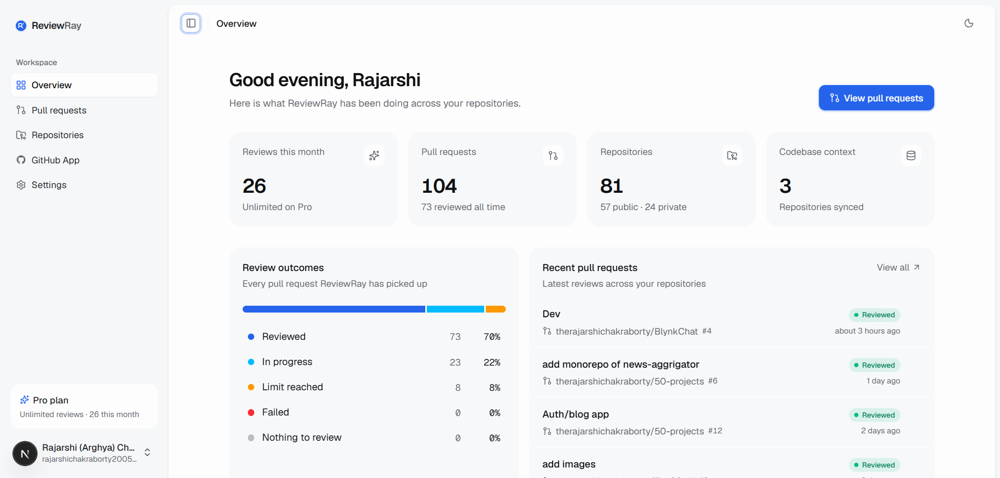
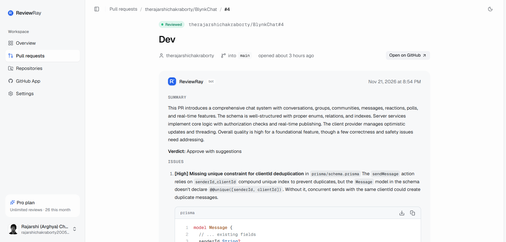

<div align="center">


# ReviewRay

**Codebase-aware AI code review for every pull request.**

ReviewRay installs as a GitHub App, reads each pull request with the context of your repository,
and posts a precise, severity-ranked review with ready-to-paste fixes in under a minute.

</div>

<br />

<p align="center">
  
</p>

<p align="center"><sub>The overview: monthly usage, review outcomes and the latest pull requests across your repositories.</sub></p>

<br />

<p align="center">
  
</p>

<p align="center"><sub>A review: a summary and verdict, then ranked issues with fixes highlighted in GitHub's own theme.</sub></p>

<br />

## Highlights

- **Context, not just the diff.** Synced repositories are indexed in Pinecone, so every review can reference related code outside the changed lines.
- **One living comment per pull request.** New pushes refresh ReviewRay's existing comment instead of piling up new ones.
- **Resilient model chain.** Every review runs on OpenRouter, and a busy or failing model hands off to the next one automatically.
- **Token-budgeted prompts.** Lockfiles, generated and binary files are dropped, patches are normalized, and source files are prioritized within a per-plan budget.
- **A consistent voice.** Every review follows the same structure: summary, verdict, severity-ranked issues with fixes, suggestions and strengths. A sanitizer keeps the output clean whichever model answers.
- **Durable background jobs.** Inngest steps retry independently, rapid pushes are debounced into a single review, and terminal failures surface in the dashboard.
- **Simple billing.** One free review a month, ten on Pro through Razorpay, enforced per installation.
- **A fast dashboard.** Instant loading states, native view transitions between pages, and per-request caching on the server.

## How it works

```
Pull request opened or updated on GitHub
        |
        v
Webhook        verify the signature, check the plan's monthly limit
        |
        v
Inngest job    resolve the plan, fetch the diff, budget the patches
        |
        v
Context        query Pinecone for related code in synced repositories
        |
        v
Generate       OpenRouter with model fallbacks, then sanitize the output
        |
        v
Publish        create or update ReviewRay's comment, store it for the dashboard
```

1. **Ingestion.** When a repository is synced, its files are chunked and upserted into a per-repository Pinecone namespace with integrated embeddings.
2. **Webhook.** The GitHub App delivers `pull_request` events. The signature is verified and monthly usage is checked before any work is queued.
3. **Diff.** The full diff and description are fetched. Noise is removed and the remaining patches are fit to the plan's budget.
4. **Context.** For synced repositories, Pinecone returns related code using the pull request title and changed paths as the query.
5. **Generation.** OpenRouter is called through a small OpenAI-compatible client with timeouts, model fallbacks and truncation handling.
6. **Publishing.** The sanitized review is written to the pull request and saved for the dashboard.

## Tech stack

| Layer          | Technology                                                                 |
| -------------- | -------------------------------------------------------------------------- |
| Framework      | Next.js 16 (App Router, Server Components, view transitions), React 19     |
| Language       | TypeScript in strict mode                                                  |
| Styling        | Tailwind CSS v4, shadcn/ui on Radix UI, Lucide icons, Geist and Instrument Serif |
| Data fetching  | TanStack Query                                                             |
| Database       | PostgreSQL (Neon) with Prisma ORM and the `pg` driver adapter              |
| Vector search  | Pinecone with integrated embeddings                                        |
| Background jobs| Inngest                                                                    |
| Authentication | Better Auth with GitHub OAuth                                              |
| GitHub         | GitHub App with Octokit and signed webhooks                                |
| AI provider    | OpenRouter for both plans, via an OpenAI-compatible client                 |
| Review rendering | Streamdown with Shiki (GitHub Light and GitHub Dark themes)              |
| Payments       | Razorpay subscriptions                                                     |
| Tooling        | Bun, ESLint, Prettier                                                      |

## AI configuration

Both plans run on OpenRouter. They differ in monthly allowance and diff budget.

| Plan | Reviews per month | Price      |
| ---- | ----------------- | ---------- |
| Free | 1                 | Free       |
| Pro  | 10                | ₹199/month |

| Variable                     | Purpose                                                     |
| ---------------------------- | ----------------------------------------------------------- |
| `OPENROUTER_API_KEY`         | Enables reviews on OpenRouter                               |
| `OPENROUTER_MODEL`           | Primary model, `google/gemma-4-31b-it:free` by default      |
| `OPENROUTER_FALLBACK_MODELS` | Comma-separated fallbacks, tried when the primary is busy   |

The OpenAI provider is kept in `features/ai/providers.ts` and `.env.example`, commented out, for a future return to OpenAI on Pro.

## Getting started

**1. Configure the environment.** Every variable is documented in `.env.example`.

```bash
cp .env.example .env
```

Subscribe the GitHub App to the **Pull request** and **Installation** webhook events.

**2. Install dependencies and prepare the database.**

```bash
bun install
bunx prisma generate
bunx prisma db push
```

**3. Run the app.** Start the Inngest dev server and Next.js in two terminals.

```bash
bunx inngest-cli dev
```

```bash
bun run dev
```

Open [http://localhost:3000](http://localhost:3000), sign in with GitHub and install the app on a repository.
