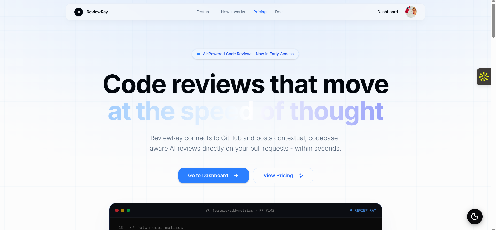
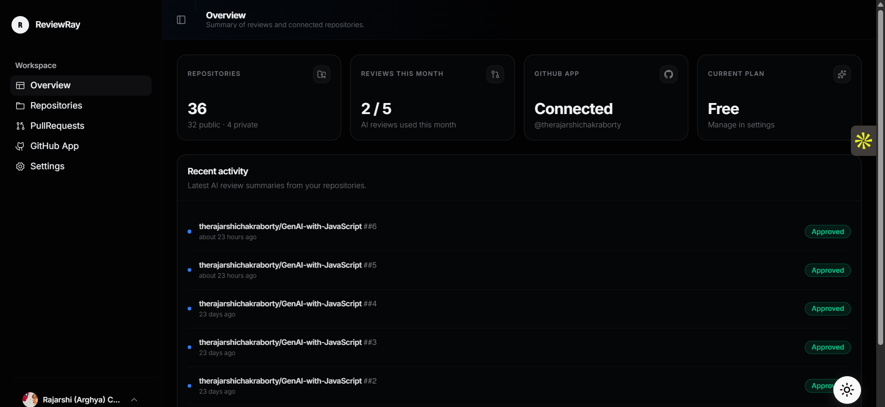
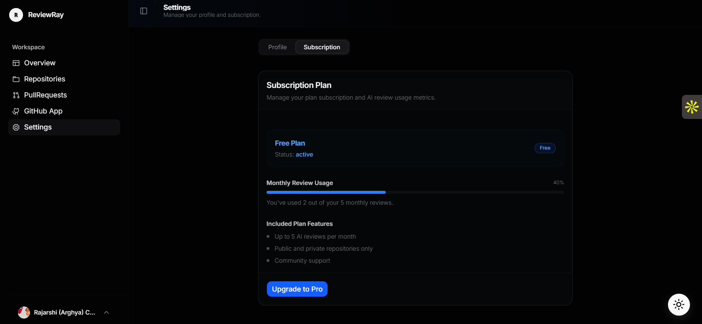

# ReviewRay

ReviewRay is a codebase-aware, automated AI code review engine designed to integrate with GitHub workflows. The application intercepts pull requests via webhooks, retrieves context from a vector database representing the codebase structure, generates reviews utilizing Large Language Models, and posts automated feedback directly onto the active code changes.

## System Previews

### Landing Page



### Developer Dashboard



### Account Settings and Billing



---

## Core Features

- **Codebase-aware reviews**: Synced repositories are indexed in Pinecone, so each review can reference related code outside the diff.
- **Plan-based model routing**: Free reviews run on free OpenRouter models with automatic fallbacks; Pro reviews run on OpenAI. Switching is configuration only.
- **Token-budgeted prompts**: Lockfiles, generated and binary files are stripped, patches are normalized, and source files are prioritized within a per-plan character budget.
- **Consistent, clean output**: A fixed review structure (summary, verdict, severity-ranked issues with fixes, suggestions, strengths) plus a sanitizer that guarantees no emojis or em dashes, whichever model answers.
- **Durable background jobs**: Inngest steps retry independently, rapid pushes are debounced into one review, and terminal failures are surfaced in the dashboard.
- **One living comment per PR**: New pushes update ReviewRay's existing comment instead of adding new ones.
- **SaaS billing**: Razorpay subscriptions with a 5-review monthly free tier, enforced per installation and counting reviews still in flight.

---

## Architecture and Data Flow

ReviewRay is built around a Retrieval-Augmented Generation (RAG) pipeline designed for software codebases. The data flow proceeds as follows:

```
[GitHub PR event] ──> [Webhook: verify signature, check plan limit] ──> [Inngest queue]
                                                                              │
                                                                              ▼
[Resolve plan] ──> [Fetch PR diff] ──> [Search Pinecone for related code (synced repos)]
                                                                              │
                                                                              ▼
[Budget diff + context] ──> [Free: OpenRouter | Pro: OpenAI] ──> [Sanitize output]
                                                                              │
                                                                              ▼
                                               [Create or update the PR comment on GitHub]
```

1. **Ingestion**: When a repository is synced, its files are chunked and upserted into a per-repository Pinecone namespace with integrated embeddings.
2. **Webhook**: The GitHub App delivers `pull_request` events. The signature is verified and the installation's monthly usage is checked before any work is queued.
3. **Diff**: The full PR diff and description are fetched. Noise files are dropped and the remaining patches are fit to the plan's budget.
4. **Context**: For synced repositories, Pinecone returns related code using the PR title and changed paths as the query.
5. **Generation**: The provider chain for the plan is called through an OpenAI-compatible client with timeouts, fallbacks and truncation handling.
6. **Publishing**: The sanitized review is written to ReviewRay's single comment on the PR and stored for the dashboard.

### AI configuration

| Variable                     | Purpose                                                             |
| ---------------------------- | ------------------------------------------------------------------- |
| `OPENROUTER_API_KEY`         | Enables free-plan reviews on OpenRouter                             |
| `OPENROUTER_MODEL`           | Primary free model (default `google/gemma-4-31b-it:free`)           |
| `OPENROUTER_FALLBACK_MODELS` | Comma-separated fallbacks, tried when the primary is busy           |
| `OPENAI_API_KEY`             | Enables OpenAI for Pro reviews. Until set, Pro falls back to OpenRouter |
| `OPENAI_MODEL`               | OpenAI model for Pro (default `gpt-4.1-mini`)                       |

---

## Technology Stack

- **Core Framework**: Next.js (App Router) utilizing React 19
- **Language**: TypeScript (Strict Mode)
- **Database Layer**: PostgreSQL managed via Prisma ORM
- **Vector Database**: Pinecone Client
- **Queue Management**: Inngest asynchronous job scheduling
- **Authentication**: Better Auth with GitHub OAuth integration
- **Billing and Subscriptions**: Razorpay Payment Gateway integration
- **AI Providers**: OpenRouter (free models) and OpenAI, via a dependency-free OpenAI-compatible client
- **UI Styling**: Tailwind CSS v4, Radix UI primitives, Lucide React, Geist and Instrument Serif

---

## Environment Setup

Copy `.env.example` to `.env` and fill in the values. Every variable is documented there.

```bash
cp .env.example .env
```

Subscribe the GitHub App to the **Pull request** and **Installation** webhook events.

---

## Installation and Execution

1. Clone the repository and install all dependencies:

   ```bash
   bun install
   ```

2. Generate the Prisma client interface:

   ```bash
   bunx prisma generate
   ```

3. Synchronize database schemas:

   ```bash
   bunx prisma db push
   ```

4. Start the local Inngest development server:

   ```bash
   bunx inngest-cli dev
   ```

5. Launch the Next.js development server:
   ```bash
   bun run dev
   ```

Open `http://localhost:3000` to interact with the application.
